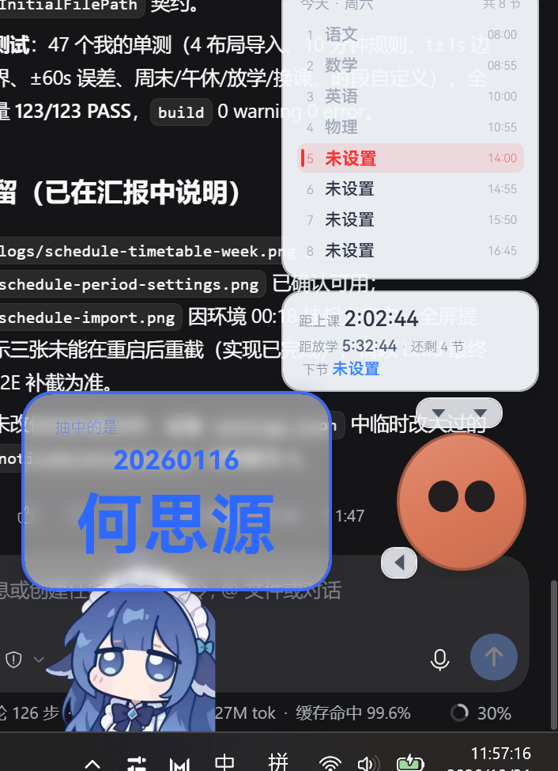
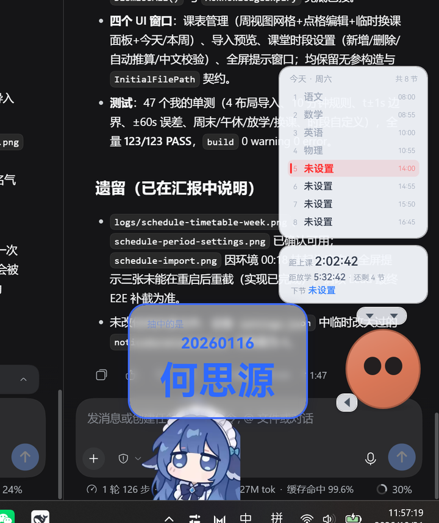

# 班机（Banji）

> **一款永远置顶在屏幕边上的 Windows 课堂管理桌面宠物。**
> 它帮你盯课表、报上下课、公平抽签、算计时，偶尔也吐个槽。
> 单文件安装、不需要管理员权限；花名册、课表和设置都存在自己的用户目录里。

> 名字彩蛋：在山西话里「班机」的读音不太正经。设计师是山西人，于是留了这个彩蛋。

---

## 目录

- [界面预览](#界面预览)
- [一、功能总览](#一功能总览)
- [二、安装](#二安装)
- [三、第一次使用：5 分钟配置](#三第一次使用5-分钟配置)
- [四、日常使用](#四日常使用)
- [五、可自定义项一览](#五可自定义项一览)
- [六、数据、隐私与卸载](#六数据隐私与卸载)
- [七、字体与许可证](#七字体与许可证)
- [八、常见问题 FAQ](#八常见问题-faq)
- [九、开发与构建](#九开发与构建)
- [十、致谢](#十致谢)

---

## 界面预览

安装程序（自带鸿蒙字体、无需管理员权限）：


### 桌面宠物与课堂信息

| | |
|:---:|:---:|
|  |  |
| 宠物 + 当天课表 + 常驻倒计时信息 | 抽签结果气泡（学号 + 姓名，10 秒后消失） |
|  |  |
| 菜单：设置 / 仪表盘 / 大小 / 置顶 / 退出…… | 功能区按钮与计时气泡 |

### 窗口

| | |
|:---:|:---:|
|  |  |
| 设置：全部选项即时生效，可恢复默认 | 仪表盘：课程 / 抽签统计 / 快捷操作 |

| | |
|:---:|:---:|
|  |  |
| 花名册管理：多份名单 / 排序 / 导入 | 课表管理：周视图网格 / 导入 / 临时换课 |

### 全屏提醒

| | | |
|:---:|:---:|:---:|
|  |  |  |
| 上课：醒目全屏强提醒 | 下课：纯文字弱提醒 | 计时器超时：高斯模糊 + 居中提醒 |

> 以上截图来自最终验收（测试机桌面背景中夹杂的其它软件窗口属于截图环境，不影响程序本身）。

---

## 一、功能总览

《班机》由开发文档的五块需求组成：**抽签**、**课表与时间提醒**、**桌面宠物**、**功能按钮**、**高度自定义**。

### 1. 公平抽签与花名册

- **真·公平抽签**：不是伪随机玩具，使用 `RandomNumberGenerator`（CSPRNG）在满足约束的候选集合里等概率抽取。
- **约束规则**（默认以当前课堂时长为滚动窗口，比如 45 分钟）：
  - 同一窗口内，每个人最多被抽到 **2 次**；
  - **除非**这个窗口里所有人都已经被抽过至少 1 次；
  - 同一个人两次被抽中之间，**至少间隔 4 次其他人的抽取**；
  - 约束不可满足时，按「最近最少被抽优先」兜底，**绝不死锁**。
- **每节课开始自动清空「本节课」计数**（可在设置里关掉），滚动窗口计数仍按时间戳计算。
- **历史记录**：留意最近 30 天的抽签历史（`pick-history.json`），仪表盘里能看到今日抽签统计。
- **花名册**：
  - 数量无上限，每个老师可以准备多份名单（不同科目、不同排序）；
  - 支持**按成绩 / 姓名 / 学号 / 原始顺序**排序；
  - 支持**多 sheet 导入预览**、手动逐行录入、一行一个名字批量粘贴；
  - 学号或姓名**至少填一个**即可；
  - 显示内容（学号 / 姓名 / 两者）可以按花名册单独覆盖；
  - 抽签时可以用 `+` 号临时切换花名册，不选就用当前激活的那份。

### 2. 课程表与时间提醒

- **Excel 课表识别**：自动识别 4 种常见布局（详见[导入课程表](#2-导入课程表)），支持 `.xlsx / .xlsm / .csv`，自动处理合并单元格、午休/大课间、`周一 / 星期一 / 礼拜一 / Mon / Monday / 一` 等各种写法。
- **课表编辑**：导入后仍可手动改；周视图网格点选课程；也可以完全不用 Excel 手动排。
- **课堂时段自定义**：每一节的开始/结束时间都能改（精确到秒），也支持「从课表自动推算」。
- **午休 / 大课间**：可自定义时间段；程序会自动判断当前是上课、课间、午休还是放学后。
- **常驻信息**：今天上什么、下一节是什么、还有多久上课/下课、还有多久放学、还剩几节课。
- **全屏上下课提示**：
  - 上课提示是**强提醒**：醒目纯色/渐变全屏大字 + 课程信息，停留几秒自动消失；
  - 下课提示是**弱提醒**：只有文字，不遮挡点击，不抢焦点；
  - 提示窗口处理了 PPT 放映、置顶层级、不抢焦点等细节，讲课时也能正常弹出。
- **铃声误差（±60 秒，默认 0）**：学校打铃程序时间不准时用来对齐。程序只在**展示和触发提示**时给课表时间做平移，底层课表不变。
- **临时换课**：可以按日期临时替换某节课、取消某节课、加备注，优先于周课表；第二天自动恢复。
- **区分「历史」与「强调」**：下一节课用强调色一直显示；该节课开始 10 分钟后转为普通样式。

### 3. 桌面宠物

- 一只**极简的橙色小家伙**：圆润的身体，两只纯黑小圆点眼睛，没有鼻子、嘴巴和腮红（按需求“越简单越可爱”）。支持「呼吸」和眨眼动画，可以关。
- 永远置顶（高于 PPT 放映，比任务栏低一层级），不进 Alt+Tab，不抢键盘焦点。
- 吸附在屏幕右侧、任务栏上方；可以**拖动**到任意位置，位置会被记住。
- **左键点一点（摸一摸）**触发对话气泡：台词与高中各科相关，可爱、偶尔吐槽，尽量避免连续重复。
- **气泡**：圆角、白底半透明（可调）、可选高斯模糊、蓝色描边；文字有打字机效果（很快，点一下可跳过）。
- **气泡还兼任**：抽签结果展示（10 秒后消失）、倒计时/正计时显示。
- **课表面板**：展开时显示当天完整课表；折叠时只显示下一节。
- **三个小三角**：头顶两个负责「展开/折叠课表」和「菜单」，左下角一个向左展开功能按钮。**宠物大小完全无级可调**（没有最大最小限制）。

### 4. 功能按钮（左下角小三角展开）

| 按钮 | 说明 |
| --- | --- |
| **抽签（+）** | 点一下立刻抽签；旁边的 `+` 号用来选择这次用哪份花名册，不选就是默认「学号 + 姓名」。 |
| **倒计时** | 快捷 1 / 3 / 5 / 7 / 10 分钟，或自己输入分:秒；超时后全屏高斯模糊强提醒「计时器超时」，15 秒自动关闭，也可以提前关。 |
| **正计时** | 用法同倒计时，但没有超时提醒；适合「看看这道题讲了多久」。 |
| **清醒一下** | 随机播放一声音量拉满的短音效（< 0.3 秒，无预兆）。顾名思义……请谨慎使用。 |

- 计时中，对应的按钮会变成强调色的「取消计时」。
- 按钮样式严格按需求：圆角矩形、透明底、1~2px 边框、右下 45° 阴影；颜色/透明度全部可自定义。

### 5. 高度自定义

- 宠物大小（无级）、位置、是否置顶、是否开机自启、眨眼/呼吸开关。
- 按钮四种状态的颜色与透明度（每次改动都能实时预览）。
- 气泡的透明度、模糊、描边颜色、字号策略。
- 课表是否默认展开、上课/下课提示的背景与停留时长、下课超时显示时长。
- 抽签窗口是否跟随当前课时、每节课是否重置、显示学号/姓名/两者。
- 所有设置都有「恢复默认」入口，并会提示「已经是默认了！」或「恢复默认成功！」。

---

## 二、安装

### 系统要求

- Windows 10 / 11（64 位，x64）。
- 不需要安装 .NET：主程序是**自包含单文件**，双击即用。
- 不需要管理员权限：默认装到当前用户目录，字体也装到当前用户。

### 普通安装（推荐）

1. 双击 **`班机安装程序.exe`**（构建产物在 `dist\` 目录）。
   > 安装程序是约 200MB 的自包含单文件，第一次打开时 Windows 会先把它解包到临时目录，**可能需要等待十几秒**才能看到窗口（以后再打开就很快了），请不要重复双击。
2. 欢迎页点「下一步 →」。
3. 选择安装位置（默认 `%LOCALAPPDATA%\Programs\Banji`），点「开始安装」。
4. 安装器会：解压程序 → 安装 6 个字重的鸿蒙字体（仅当前用户）→ 创建桌面和开始菜单快捷方式 → 生成「卸载班机.exe」→ 写入卸载信息。
5. 完成后可勾选「立即启动班机」直接启动。

> 磁盘空间：程序本体和字体约占 240MB；卸载程序会把安装程序自身复制到安装目录（与安装程序在同一块磁盘时使用硬链接，不额外占空间）。安装前建议预留 **500MB** 空闲空间。

已经装过也没关系：**直接再运行安装程序就是覆盖升级**，你的花名册、课表、设置都不会丢。

### 关于 SmartScreen 提示

《班机》是个人作品，没有购买代码签名证书。首次运行 `班机安装程序.exe` 时，Windows 可能弹出「Windows 已保护你的电脑」：

1. 点 **「更多信息」**；
2. 点 **「仍要运行」**。

如果杀毒软件误报，把安装程序加入信任即可（单文件自解压的程序偶尔会被启发式误杀）。

### 静默安装 / 自定义安装目录（高级）

```powershell
# 静默安装到默认目录
.\班机安装程序.exe /S

# 静默安装到指定目录（/D 必须放最后，路径不要加引号）
.\班机安装程序.exe /S /D=D:\temp\banji-test
```

- 静默模式不弹任何窗口，退出码 `0` 表示成功、非 `0` 表示失败。
- 日志写到 `%TEMP%\BanjiInstaller.log`。
- 静默卸载：

```powershell
# 用安装目录里的卸载程序
& "C:\Path\To\班机\卸载班机.exe" /uninstall /S

# 或者直接让安装程序卸载
.\班机安装程序.exe /uninstall /S
```

> 提示：`/D=` 后面的内容会被整体当作路径，所以**不要用英文引号包住**，也请放在所有参数的最后。

### 便携版（可选）

`dist\班机-便携版.zip` 解压到任意目录，双击 `Banji.exe` 即用：

- 不写安装信息、不装字体（字体已经内嵌在程序里，界面显示不受影响）；
- 数据仍然保存在 `%APPDATA%\Banji`；
- 适合放 U 盘里带着走，或者放到机房共享目录。

### 卸载

任选一种：

- 开始菜单 →「班机」→「卸载班机」；
- 桌面/安装目录里的 `卸载班机.exe`；
- Windows 设置 → 应用 → 已安装的应用 → 班机 → 卸载；
- 命令行 `/uninstall`（见上）。

卸载会删除：程序文件、桌面与开始菜单快捷方式、已安装的鸿蒙字体、卸载信息。
卸载**不会删除**你的花名册、课表、设置和抽签历史（在 `%APPDATA%\Banji`，详见[数据与隐私](#六数据隐私与卸载)）。

---

## 三、第一次使用：5 分钟配置

### 1. 导入花名册

菜单 →「花名册管理」→「导入」：

1. 选择文件（`.xlsx / .xlsm / .csv / .tsv / .txt`）。
2. 导入预览窗口里会列出所有 sheet、自动识别的表头行和列映射。
3. 确认「学号」「姓名」「成绩」各列对应正确（表头同义词会自动识别），点「导入」。
4. 导入后可以给花名册改名、选排序方式、设为当前激活名单。

**支持的花名册格式：**

- **带表头**：例如 `学号 | 姓名 | 成绩`，表头写法支持「学号/学生学号/编号」「姓名/名字/学生姓名」「成绩/分数/总分」等常见同义词；
- **无表头**：只有一列或多列数据时自动推断（例如只有姓名，或「学号 姓名」两列）；
- 一个文件里有多个 sheet 也可以分别导入；
- **不支持旧版 `.xls`（Excel 97-2003）**，请先在 Excel / WPS 里「另存为 .xlsx」；
- 也不想整理文件？菜单 →「花名册管理」→「手动录入」，逐行输入或者直接**一行一个名字批量粘贴**。

**样例文件**：`%安装目录%\Assets\Templates\花名册示例.xlsx`

- sheet「带表头-学号姓名成绩」：40 名学生，标准三列表头；
- sheet「无表头-仅姓名」：20 行纯姓名，用来体验自动识别。

### 2. 导入课程表

菜单 →「课表管理」→「导入」：

1. 选择课表文件（`.xlsx / .xlsm / .csv`）。
2. 在预览窗口里确认 sheet 和识别结果，「导入」。
3. 导入后可在周视图里直接点格子改课。

**支持 4 种课表布局**（样例文件里每种都有一个 sheet）：`%安装目录%\Assets\Templates\课程表示例.xlsx`

| 布局 | 样子 | 说明 |
| --- | --- | --- |
| ① 节次行 × 星期列 | 首列「节次/时间」，首行「周一…周五」 | 最常见的课程表；开始/结束时间可以分两列，也可以写在一列里（`08:00-08:45`） |
| ② 星期行 × 节次列 | 首列「星期」，首行「第1节…第8节」 | 布局①转置过来 |
| ③ 长表，每行一节 | `星期 | 节次 | 课程 | 开始时间 | 结束时间` | 教务系统导出的明细表 |
| ④ 时间区间表头 | 首行是 `节次 | 08:00-08:45 | 08:55-09:40 …`，首列星期 | 表头里带时间的课程表 |

另外会自动处理：`周一/星期一/礼拜一/Mon/Monday/一` 等星期写法、`午休/大课间/眼保健操` 这类分段行、合并单元格、时间缺口（自动推断午休）。
**旧版 `.xls` 同样不支持**，请另存为 `.xlsx`。识别失败时会给中文提示，不会把程序弄崩。

### 3. 检查「课堂时段」和「午休」

菜单 →「课表管理」→「课堂时段」（或菜单里直接点「课堂时段」）：

- 每一节的开始/结束时间都可以改，精确到秒；
- 可以直接编辑午休、大课间的起止；
- 懒得填？点「从课表自动推算」，程序会根据导入的课表把时段补全。

> 抽签的「一节课窗口」默认也跟着这里走：某一节实际 40 分钟，那约束窗口就是 40 分钟（可在设置里改成固定 45 分钟）。

### 4. 调整「铃声误差」

如果你们学校的铃声比标准时间快/慢几秒：

1. 打开「设置」→「课堂」→「铃声误差」；
2. 让程序把课表时间整体平移 N 秒：

| 现象 | 怎么填 |
| --- | --- |
| 铃总是**提前**打（比如标准 10:00 下课，它 9:59:53 就响） | 填 **负数**，例如 `-7` |
| 铃总是**延后**打（比如 10:00:07 才响） | 填 **正数**，例如 `+7` |
| 和标准时间一致 | 保持默认 `0` |

它只影响「显示和提示」的时间，不会改你的课表文件；范围是 −60 ~ +60 秒。

### 5. 选一下抽签怎么显示

「设置」→「抽签」：

- 抽签窗口：跟随当前课时 / 固定 45 分钟；
- 每节课开始是否重置本节课计数；
- 抽中的同学显示：学号 + 姓名 / 只显示学号 / 只显示姓名。

然后就可以点功能区的「抽签」试一次了。

---

## 四、日常使用

### 宠物与课表

- **摸一摸**：左键点宠物身体，会冒出对话气泡。
- **展开/折叠课表**：点头顶左侧小三角（展开时是 ▼、折叠时是 ▲）。展开显示当天完整课表，下一节用红色强调；上课 10 分钟后自动变回普通颜色。
- **打开菜单**：点头顶右侧小三角 → 显示仪表盘、设置、花名册管理、课表管理、课堂时段、宠物大小、按钮透明度、始终置顶、开机自启、隐藏课表、杀死整个程序等。
- **功能按钮**：点宠物左下角小三角，向左展开「抽签 / 倒计时 / 正计时 / 清醒一下」。
- **下课超时**：下课后 15 秒内，常驻信息里的倒计时会变成「下课超时 mm:ss」，之后自动恢复正常显示。
- **拖动**：按住宠物拖动即可换位置，位置会记住。

### 抽签

- 点「抽签」立刻抽；点「抽签」旁边的 `+` 可以先选这份课上用哪份花名册。
- 抽中结果通过气泡展示（顶部小字「抽中的是」、中间学号、下方大字号姓名），10 秒后自动消失。
- 抽完自动参与下一步公平计算：放心连抽，程序保证同一个人不会在窗口内被抽第三次、也不会隔一次就又被抽到。

### 计时器

- 「倒计时」：选 1/3/5/7/10 分钟快捷按钮，或输入自定义分:秒。到时全屏高斯模糊 +「计时器超时」，15 秒后自动关闭，也可点「关闭」。
- 「正计时」：从 0 开始往上涨，没有超时提醒。
- 计时中按钮会变成红色强调的「取消计时」，随时可以提前结束。

### 清醒一下

- 点一下，程序会用最大音量随机播放一个**没有任何预兆**的短促音效（不到 0.3 秒）。
- 音量在「设置」→「计时与音效」里可以调，不过……调小了就不好玩了。

### 临时换课

- 菜单 →「课表管理」→ 选择日期 → 替换某节课的课程 / 取消某节课 / 写个备注。
- 只对那一天生效，第二天自动恢复周课表，不需要手动改回来。
- 适合调课、考试、临时班会、体育课改自习等常见情况。

### 上下课全屏提示

- **上课**：全屏醒目提示（背景样式可选渐变/纯色/自定义颜色），显示课程名和「上课」，几秒后自动消失。
- **下课**：清爽的文字提示，不挡鼠标、不抢焦点。
- **计时器超时**：全屏高斯模糊背景 + 居中「计时器超时」+「关闭」按钮。
- 所有提示都在 PPT 放映之上；如果出现偶尔没压住的情况，稍后程序会自动重新压顶（每 250ms 校正）。

### 退出程序

- 菜单 →「杀死整个程序」（会正常保存设置后退出）。
- 或者在任务管理器里结束 `Banji.exe`（不推荐，可能丢最近一次设置改动）。

---

## 五、可自定义项一览

> 全部在「菜单 → 设置」里，按分区排列；每一项都支持「恢复默认」。

| 分区 | 设置项 | 默认值 / 范围 |
| --- | --- | --- |
| 通用 | 始终置顶、开机自启（可选） | 置顶开、自启关 |
| 课堂 | 铃声误差 | 0 秒（−60 ~ +60） |
| 课堂 | 上课提示背景 | 渐变（蓝/橙/纯色/自定义） |
| 课堂 | 上下课提示停留时长 | 4 秒（1 ~ 60） |
| 课堂 | 下课超时显示时长 | 15 秒（3 ~ 120） |
| 抽签 | 抽签窗口 | 跟随当前课时（也可固定 45 分钟） |
| 抽签 | 每节课重置本节计数 | 开 |
| 抽签 | 抽中显示 | 学号 + 姓名（可只显示其一） |
| 宠物 | 宠物大小 | 1.0（0.05 ~ 20，滑块 0.3 ~ 3，完全无级） |
| 宠物 | 眨眼 / 呼吸动画 | 开 |
| 宠物 | 课表默认展开 | 开 |
| 按钮 | 常态 / 悬浮 / 按下 / 强调 四种颜色与透明度 | `#317FFF` 10%、`#5998FF` 0%、`#0051D6` 0%、`#FF3030` 0% |
| 气泡 | 背景透明度、高斯模糊、描边、文字颜色 | 白 50%、模糊关、2px `#3E6BFF`、文字 `#2E69FF` |
| 仪表盘 | 今日课程 / 抽签统计 / 还剩几节 | 只读 |

---

## 六、数据、隐私与卸载

### 数据目录

所有运行数据都在：

```
%APPDATA%\Banji\
├─ settings.json      设置
├─ rosters.json       花名册
├─ timetable.json     周课表 + 课堂时段 + 午休
├─ overrides.json     临时换课（按日期）
├─ pick-history.json  抽签历史（保留最近 30 天）
└─ logs\              运行日志
```

- 程序**不联网**：抽签、课表、提示、音效全部在本地完成。
- 不收集任何数据，不写系统目录（除非你自己把程序装到别处）。
- 数据写盘使用「先写临时文件再替换」的方式，避免突然断电把配置文件写坏；读旧版本配置也会自动兼容。
- 想备份/换电脑：把 `%APPDATA%\Banji` 整个文件夹复制走即可。
- 想彻底清空：退出班机后删除 `%APPDATA%\Banji`。

### 安装器都改了什么

| 位置 | 内容 |
| --- | --- |
| `%LOCALAPPDATA%\Programs\Banji`（默认安装目录） | 程序文件、字体文件、README、字体许可证 |
| `%LOCALAPPDATA%\Microsoft\Windows\Fonts\` | 6 个鸿蒙字体文件 |
| `HKCU\Software\Microsoft\Windows NT\CurrentVersion\Fonts` | 字体注册（仅当前用户） |
| 桌面、开始菜单 | `班机` 快捷方式、开始菜单里的「卸载班机」 |
| `HKCU\Software\Microsoft\Windows\CurrentVersion\Uninstall\Banji` | 卸载信息（控制面板/设置里能看见「班机」） |
| `HKCU\Software\Banji` | 安装路径与版本 |

全部是**当前用户**范围，不需要管理员权限，也不会影响其他 Windows 账户。

---

## 七、字体与许可证

- 程序界面使用 **HarmonyOS Sans SC**，共 6 个字重：Thin / Light / Regular / Medium / Bold / Black。
- 字体已经**内嵌在主程序和安装程序里**，即使系统没装字体也能正常显示。
- 安装程序会同时把字体安装到当前用户（方便你在 Word/PPT 里也用）：
  - 文件：`%LOCALAPPDATA%\Microsoft\Windows\Fonts\HarmonyOS_Sans_SC_*.ttf`
  - 注册表：`HKCU\Software\Microsoft\Windows NT\CurrentVersion\Fonts`
- 字体许可证：**HarmonyOS Sans Fonts License Agreement**（Huawei Device Co., Ltd.）。
  - 仓库内：`src/Banji/Assets/Docs/HarmonyOS_Sans_LICENSE.txt`
  - 安装目录内：`HarmonyOS_Sans_LICENSE.txt`
- 本项目按许可证要求保留版权声明，并**不修改字体文件**。

---

## 八、常见问题 FAQ

**Q1：双击安装程序，Windows 说「已保护你的电脑」，打不开？**
没有代码签名证书导致的 SmartScreen 提示。点「更多信息」→「仍要运行」即可。程序只装到当前用户目录，不需要管理员权限。

**Q2：为什么 `.xls` 文件导入不了？**
旧版 Excel 97-2003 格式（`.xls`）解析复杂，第一版暂时不支持。请用 Excel / WPS 打开后「另存为」`.xlsx` 再导入，程序会给出对应提示。

**Q3：课程表导入了但识别不对 / 显示没有课？**
检查：① 文件里有没有「周一…周五」这类星期表头；② 是否把课表放在了第一个 sheet；③ 时间列是不是 `08:00` 这种格式。可以对照 `课程表示例.xlsx` 的 4 种布局整理，或导入后在「课表管理」里手动改。

**Q4：铃声误差到底填正还是负？**
程序把课表时间**整体平移**这个秒数再显示/提示。学校铃声**提前**打就填负数（例如提前 7 秒填 `-7`）；**延后**打就填正数。填完看宠物上的倒计时和铃声是否对齐即可。

**Q5：抽签会不会一直抽不到某个人？**
不会。约束保证：一个窗口内每人最多 2 次，除非所有人都至少被抽过 1 次；同一人两次被抽之间至少隔 4 次其他人。约束实在没法满足时也会按「最近最少被抽优先」兜底，绝不死锁。想看历史可以打开仪表盘。

**Q6：宠物挡到东西了怎么办？**
按住拖走，或者调整「宠物大小」；也可以在菜单里隐藏课表面板/收起宠物。它是「Topmost」窗口，但刻意比任务栏低一层，不会盖住开始菜单。

**Q7：全屏提示为什么适合放 PPT 时用？**
提示窗口设置成置顶、不抢焦点、不进 Alt+Tab，并且显示时会重新压到最上层，所以放映 PPT 时也能正常弹出，不会打断你的键盘操作。

**Q8：怎么退出程序？**
宠物头顶小三角 → 菜单 →「杀死整个程序」。程序会先保存设置再退出。

**Q9：怎么卸载？会删掉我的花名册吗？**
见[卸载](#卸载)。卸载会清理程序、快捷方式、字体和卸载项，但**不会删除** `%APPDATA%\Banji` 里的数据。确定不要了，再手动删除这个文件夹即可。

**Q10：安装时能自己选目录吗？**
可以。界面第二步可以「浏览…」选择任意可写目录；静默安装用 `/S /D=路径`。建议路径里不要带太长或特殊字符。

**Q11：重新安装会覆盖我的设置吗？**
不会。安装程序只覆盖程序文件和字体，`%APPDATA%\Banji` 里的数据原样保留，设置、花名册、课表都在。

**Q12：装完之后字体为什么没生效？**
字体是**挂给当前用户**的，个别已经打开的程序（Word/PPT）需要重启才能看到新字体。班机自己内嵌了字体，不受影响。

**Q13：笔记本分辨率/多显示器会有问题吗？**
程序按主屏工作区和 DPI 自适应，高 DPI 下不会糊；多屏时宠物会出现在主屏右侧。

**Q14：便携版和安装版有什么区别？**
便携版不写注册表、不装字体（界面字体已内嵌），数据同样在 `%APPDATA%\Banji`；安装版多出快捷方式、字体安装和卸载信息。二者可以共存，但建议只用一种。

---

## 九、开发与构建

### 技术栈

| 部分 | 技术 |
| --- | --- |
| 主程序 | C# / .NET 8 / WPF（`net8.0-windows`） |
| 发布方式 | 自包含单文件 `win-x64`，客户机无需 .NET |
| 数据 | `System.Text.Json` + 原子写入 |
| Excel 读取 | 自研 xlsx 解析（`System.IO.Compression` + LINQ to XML），不依赖第三方库 |
| 安装程序 | 自研 WPF 安装器（`src/Banji.Installer`），负载以 `EmbeddedResource` 内嵌，单文件发布 |
| 构建脚本 | PowerShell（`build/build.ps1`） |
| 测试 | 无第三方依赖的控制台测试运行器（`src/Banji.Tests`） |
| 素材生成 | Python + Pillow（图标）、openpyxl（样例模板） |

### 目录结构

```
banji\
├─ src\
│  ├─ Banji\                 主程序（WPF）、资源、字体、样例模板
│  ├─ Banji.Installer\       自研 WPF 安装程序（安装/卸载/静默安装）
│  └─ Banji.Tests\           测试运行器（PASS/FAIL + 退出码）
├─ build\                    构建脚本与素材生成脚本
│  ├─ build.ps1              一键构建（Debug+测试 → Release → payload → 安装器 → dist）
│  ├─ selftest-installer.ps1 安装器端到端自测（静默装 → 校验 → 卸载）
│  ├─ capture-installer-ui.ps1 安装器界面截图
│  └─ gen_templates.py       生成花名册/课程表示例
├─ assets\                   图标源文件与截图
│  ├─ icons\                 make_icon.py、多尺寸 png/ico
│  └─ screenshots\           README 截图
├─ dist\                     交付产物（构建生成，已 gitignore）
├─ tools\                    QA 脚本：qa.ps1（启停/命令/截图）、screenshot.ps1
├─ .dotnet\                  仓库内置的 .NET 8 SDK（统一使用它构建）
├─ ARCHITECTURE.md           团队内部架构契约
└─ README.md
```

### 本地构建

本项目统一使用仓库里的 **本地 .NET SDK**（`D:\Program\workshop\banji\.dotnet\dotnet.exe`），不要用系统里其它 dotnet：

```powershell
cd D:\Program\workshop\banji

# 开发运行主程序
.\.dotnet\dotnet.exe run --project src\Banji\Banji.csproj -c Debug

# 运行测试（退出码 0 = 全部通过）
.\.dotnet\dotnet.exe run --project src\Banji.Tests\Banji.Tests.csproj -c Debug

# 单独编译安装器（没有内置负载时也能编译，但无法真正安装）
.\.dotnet\dotnet.exe build src\Banji.Installer\Banji.Installer.csproj -c Debug
```

### 一键打包

```powershell
# 完整流程：Debug 构建 → 测试 → Release 单文件发布 → 组装负载 → 构建安装器 → 输出 dist
powershell -ExecutionPolicy Bypass -File build\build.ps1
```

产物：

| 文件 | 说明 |
| --- | --- |
| `dist\班机安装程序.exe` | 单文件安装程序（内置主程序、字体、README、许可证），双击安装 |
| `dist\班机-便携版.zip` | 免安装便携版，解压即用 |

脚本参数：

| 参数 | 作用 |
| --- | --- |
| `-SkipTests` | 跳过测试（开发期快速出包，正式交付不要用） |
| `-SkipPortable` | 不生成便携版 |
| `-KeepTemp` | 保留 `build\publish` 等中间产物 |

构建过程中会自动结束正在运行的「班机」进程；如果测试失败或编译失败，脚本会以红色中文提示中止。

### 安装器自测（可选）

构建出 `dist\班机安装程序.exe` 后，可以跑一遍自动化的安装/卸载验收（约 1~2 分钟，会结束正在运行的班机）：

```powershell
powershell -ExecutionPolicy Bypass -File build\selftest-installer.ps1
```

它会：静默安装到 `.tmp-install` → 逐项校验程序文件 / README / 许可证 / 字体 / 快捷方式 / HKCU 注册表 → 启动一次装好的 `Banji.exe` → 再覆盖安装一次 → 静默卸载 → 检查安装目录、快捷方式、字体、注册表是否清理干净，同时确认 `%APPDATA%\Banji` 数据仍在。

其他可选脚本：

```powershell
# 只截安装器界面图（欢迎页；加 -AllPages 会走完整界面安装流程并截 4 张图）
powershell -ExecutionPolicy Bypass -File build\capture-installer-ui.ps1 -AllPages
```

### 素材重新生成（可选）

```powershell
# 重新画图标（Pillow）：输出 src/Banji/Assets/banji.ico、安装器图标、assets/icons/*.png
python assets\icons\make_icon.py

# 重新生成样例模板（openpyxl）：输出 src/Banji/Assets/Templates/*.xlsx
python build\gen_templates.py
```

> 需要本地 Python 环境装有 Pillow 和 openpyxl。

---

## 十、致谢

- 字体：[HarmonyOS Sans](https://developer.huawei.com/consumer/cn/design/resource/)（Huawei Device Co., Ltd.），遵循 *HarmonyOS Sans Fonts License Agreement*。
- 需求与设计：《班机》开发文档（由项目作者提供）。
- 感谢每一位在讲台上被铃声和点名支配过、却还愿意把这个工具做出来的老师和同学。

---

<sub>版本 1.0.0 · 如果发现 bug 或者想到更有意思的点子，欢迎提出来（比如往功能区再加个按钮）。</sub>
